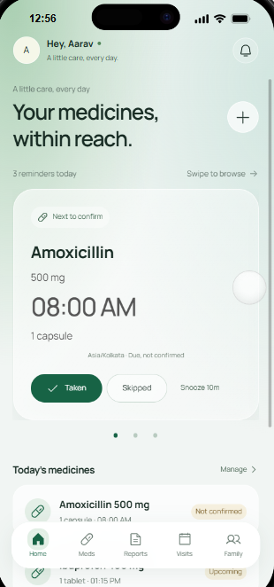
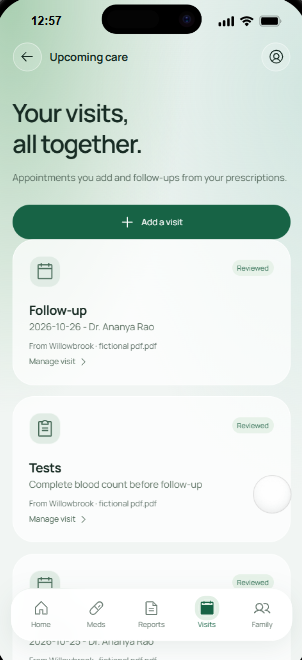
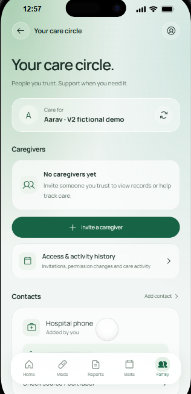
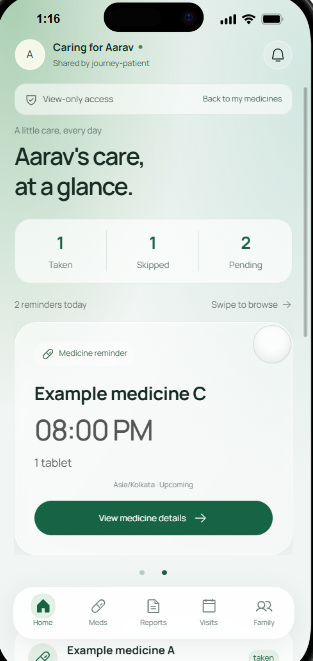

# AfterCare

AfterCare is a personal medicine and care organizer built with React, TypeScript and FastAPI. Add a prescription or enter medicines yourself, review the details, set reminders and record doses. A patient can invite a caretaker to follow their care journey through a separate account.

The current V2 runs as a local web app with iPhone and Pixel development previews. It includes the application and an HTTPS deployment configuration; public hosting, phone installation and real-device background notification delivery still require verification.

## App preview

Patient and caretaker screens from the local web app, using fictional demo records. The caretaker view shown here has view-only access and displays recorded care statuses.

| Patient Home & reminders | Visits & follow-ups |
| :---: | :---: |
|  |  |

| Care circle | Caretaker's shared journey |
| :---: | :---: |
|  |  |

## Features

- **Prescription import:** read supported PDFs, scans and photos locally. Keep the original document and highlighted source evidence alongside corrections. Missing or unclear details remain explicit.
- **Manual medicines:** add medicines without uploading a document. Entries are labelled as user-entered and use the same reminder and tracking workflow.
- **One review overview:** edit extracted information together, fill missing details and confirm the reviewed information. This confirms transcription, not treatment suitability or clinical approval.
- **Personal reminders:** choose course dates, time zone and reminder times. A saved wake, meal and sleep routine suggests times for suitable instructions. Explicit times and intervals remain authoritative; as-needed or unresolved instructions do not become fixed repeating reminders.
- **Daily tracking:** swipe Home reminders one card at a time, with dots showing the current card. Record Taken or Skipped, snooze for ten minutes, or undo a recording mistake with history retained. Medicines remain available across the selected person's saved records.
- **Caretaker access:** invite an existing account as a viewer or recorder. After acceptance, **People you support** opens a shared journey with doses, prescriptions, visits and recent updates. The owner chooses taken, skipped and not-confirmed alerts and can revoke access. No recorded confirmation is not proof of a missed dose.
- **Visits and contacts:** keep source-listed follow-ups alongside separately labelled appointments added by the user. Source dates do not create bookings automatically. Reviewed hospital numbers and manual contacts support tap-to-call.
- **Medicine information:** show report context, explicitly documented purposes and source-attributed reference facts. The offline reference collection covers 13 exact generic names; unsupported personal indications and unknown medicine matches are not guessed.
- **Record management:** export, archive, restore or permanently delete records. Accounts, source evidence, dose history and originals are encrypted at rest. Offline tools provide encrypted installation backup and restore.

The Home profile initial opens Account settings. Existing profile and document-group organization remains available without requiring a recovery-space setup in normal personal use.

## Typical workflow

1. Create an account and upload a prescription or add medicines manually.
2. Review the details in one overview, correct mistakes and fill missing information.
3. Confirm suitable reminder times, course dates and a time zone, using daily-routine suggestions where appropriate.
4. Track doses from Home and manage appointments, prescriptions and contacts in their own sections.
5. Optionally invite a caretaker. After accepting through their own account, they can follow the shared journey with the permissions and updates chosen by the owner.

## How it works

| Part | Implementation |
| --- | --- |
| Interface | React and TypeScript, with a supplied mobile preview runtime and app-specific mint styling |
| API | FastAPI with authenticated cookie sessions and permission checks |
| Document reading | PyMuPDF for PDF text; local Tesseract for supported scans, photos and ruled tables |
| Optional AI | Local Ollama with `phi4-mini:latest`, used as an extraction fallback and to select supported reference facts |
| Storage | SQLite in memory, persisted as encrypted snapshots; encrypted original documents |
| Notifications | In-app updates, foreground checks and optional background Web Push |

The reader runs deterministic extraction first. Available local Phi can assist when no medicine was identified. Missing OCR or model support never switches processing to an external AI service. Corrections retain the original evidence and history.

Reminder activation requires explicit user confirmation of reviewed details and chosen times. Changes to source details suspend reminders until reconfirmed; changing a daily routine does not silently move active reminders. Overlapping plans for the same medicine are guarded against. The backend rechecks permissions and record revisions when saving changes.

The encrypted snapshot design supports a small installation with **one API process**. It is not a multi-worker database service. See [architecture and operations](docs/V2.md) for storage, key handling, sharing and reminder rules.

## Run locally on Windows

Requirements: Python 3.11+ and Node.js 22.18+.

From the repository root:

```powershell
python -m venv .venv
.venv/Scripts/python.exe -m pip install -r backend/requirements-lock.txt
npm.cmd --prefix frontend ci
npm.cmd --prefix frontend run build
.venv/Scripts/python.exe scripts/run.py
```

Open [AfterCare](http://127.0.0.1:8000/). The launcher serves the built interface and API together, logs to `data/server.log` and stops with Ctrl+C. `AFTERCARE_DATA` selects another installation folder. Keep the server running while using the app.

### Optional document-reading tools

- **Scans and photos:** install Tesseract with English language data and set `TESSERACT_CMD` if it is not discoverable. If Conda is installed, `scripts/setup-ocr.ps1` creates the project's `.tools/ocr` installation. Tools and patient data are excluded from Git.
- **Local AI:** install Ollama, then run `ollama pull phi4-mini:latest`. `AFTERCARE_AUTO_AI=0` disables automatic extraction fallback. No cloud model key is required or embedded in the frontend.

Text PDFs and manual medicine entry work without these optional tools. Handwriting and unfamiliar layouts can require manual entry.

### Try the caretaker workflow

With the API stopped, run:

```powershell
.venv/Scripts/python.exe scripts/demo.py
```

This creates a fictional prescription and two local demonstration accounts:

| Role | Username | Password |
| --- | --- | --- |
| Owner | `aftercare-demo` | `Aftercare-demo-2026!` |
| Caretaker | `aftercare-helper` | `Aftercare-helper-2026!` |

The script refuses to overwrite existing demo accounts and creates no active reminder or sharing grant. Start the server, sign in as the owner, review the example and choose reminder settings. Invite the helper through Family. Sign in as the helper in a separate browser profile to accept and open **People you support**.

Viewer access cannot record doses or edit prescriptions. Recorder access can record permitted care actions; it cannot edit prescriptions, activate reminders or delegate access.

## Notifications and privacy

Enable notifications explicitly from **Reminders & updates**. In-app dose lists and caretaker updates work without browser permission. Background Web Push needs a supported secure-context browser, permission, a subscription, internet access and a running API. Browser and OS behavior can delay or suppress delivery; reminders are not guaranteed alarms.

Document processing happens on the machine running the Python API. With a hosted installation, documents are uploaded to that server and processed there. Patient files are never sent to an external AI service. Push payloads contain generic prompts and opaque IDs, without patient, medicine or document text; push providers receive delivery metadata.

The browser does not cache patient files for offline access. ZIP exports are unencrypted report copies, not account backups. Deleting an app record does not erase previously downloaded files or backups. Offline encrypted backup and restore are documented in [V2.md](docs/V2.md).

## Phone access and deployment

`localhost:8000` works on the computer running AfterCare. A phone needs a reachable server address; the local launcher only listens on that computer's loopback interface.

`Dockerfile`, `compose.yaml`, `Caddyfile` and `.env.example` provide configuration for serving the frontend and API together over HTTPS. Deployment requires a public origin, secure cookies, persistent storage and an externally managed encryption key. Follow [deployment documentation](docs/V2.md) and verify the target host and notification delivery before release. Frontend-only hosting does not supply the API or records.

This repository does not yet provide an Android APK, App Store package or finished installable PWA. The device frames are development previews. A phone release needs a real-device presentation and installation checks. Offline phone use additionally needs encrypted on-device records, device-scheduled notifications and synchronization for caretaker updates; these are not implemented in this version. Packaging the interface alone does not put Python, Tesseract or Phi on the phone.

## Development and checks

For development, run one API worker on port 8000 and Vite on 5173. App UI lives in `frontend/src/Prototype.tsx` and `prototype.css`; API types are in `api.ts`. The supplied mobile runtime has integrity checks; its optional paging mode supports the Home reminder cards while ordinary rails keep free scrolling.

Run the release checks from the repository root:

```powershell
.venv/Scripts/python.exe scripts/check.py
```

This runs isolated backend tests, frontend behavior tests, TypeScript, the production build and integrity checks for all 28 protected runtime files. Tests cover source alignment, timing constraints, permissions, caretaker consent, record deletion, encryption and restore. OCR examples are regressions, not a general extraction accuracy benchmark.

Run browser interaction tests separately:

```powershell
cd frontend
npm.cmd exec playwright install chromium
npm.cmd run test:runtime
```

These exercise carousel gestures and paging, nested scrolling, sheets, navigation and the simulated keyboard/device layouts.

AfterCare organizes entered and reviewed instructions. It does not diagnose, prescribe, validate treatment or prove medicine ingestion. Custom ML training, a full extraction benchmark and a broader dependent-management interface remain deferred. [AFTERCARE_SPEC.md](AFTERCARE_SPEC.md) records the agreed scope; historical clinician-gated milestones are superseded by its current revision.
