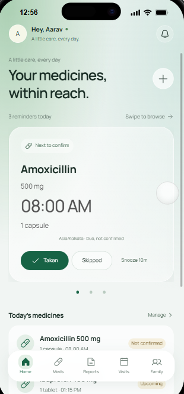
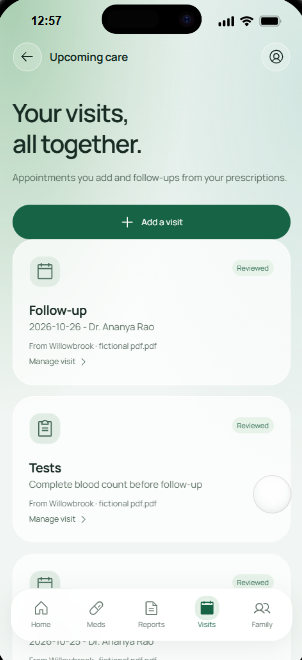
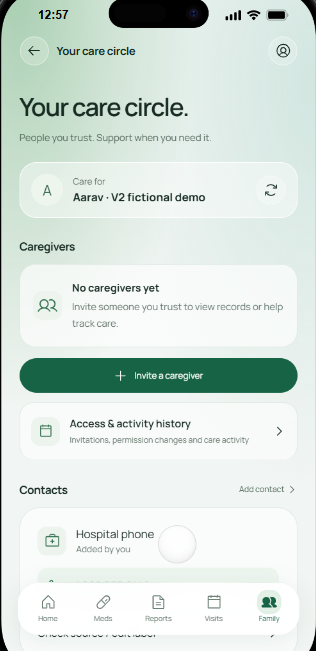
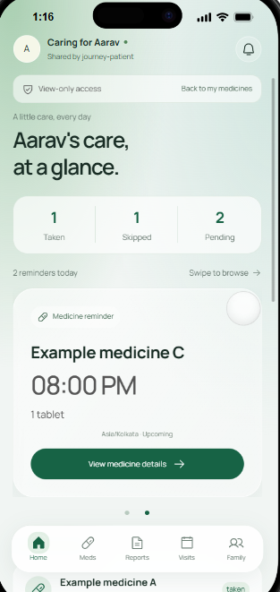

<div align="center">

# AfterCare

**Your medicines. Your routine. Your care circle.**

Turn a prescription into a daily plan you can review, follow and share with someone you trust.

**React + TypeScript · FastAPI · Local OCR · Private care sharing**

[Screenshots](#see-aftercare) · [Features](#what-you-can-do) · [Run locally](#run-locally) · [Architecture](#how-it-works) · [Development](#development-and-checks)

</div>

AfterCare brings prescriptions, medicine reminders, appointments and care updates into one place. Upload a PDF or photo, or enter medicines yourself. Review the details together, choose reminder times and record your daily care. Invite a caretaker through their own account to follow your journey with the access you choose.

Built around a simple idea: the patient manages their care, and the people they trust can stay informed. Document processing runs on your own installation, with original evidence preserved alongside every correction.

## See AfterCare

Patient and caretaker views from the web app. All screenshots use fictional demo records; the caretaker shown has view-only access.

| Your day, at a glance | Your visits, together |
| :---: | :---: |
|  |  |
| Swipe between reminders and record a dose. | Add appointments and track follow-ups. |

| People you trust | A caretaker's view |
| :---: | :---: |
|  |  |
| Manage access, invitations and useful contacts. | Follow shared care through a separate account. |

## What you can do

- **Start with a prescription or a blank form.** Read supported PDFs, scans and photos locally, or add medicines without uploading a file. Original documents and source evidence stay available after corrections.
- **Review everything together.** Edit extracted details in one overview, fill gaps and confirm the information. Missing instructions remain visible rather than being guessed.
- **Fit reminders around your day.** Choose course dates, a time zone and reminder times. Your saved wake, meal and sleep routine suggests suitable times while preserving explicit prescription constraints.
- **Track daily care.** Swipe between Home reminder cards, record Taken or Skipped, snooze for ten minutes and undo mistakes with history retained. Manual medication records stay separate from scheduled doses.
- **Bring someone you trust into the loop.** Invite an existing account as a viewer or recorder. After acceptance, they can open **People you support**, follow your shared journey and receive selected updates. You can revoke access.
- **Keep visits and contacts close.** Add appointments alongside prescription follow-ups. Reviewed hospital numbers and manual contacts support tap-to-call.
- **Understand medicine information.** Structured medicine details distinguish general reference facts, a stated personal purpose and report context, with source attribution. The local collection covers 13 exact generic names; unknown matches and personal indications are not inferred.
- **Control your records.** Export, archive, restore or delete reports. Server records and originals are encrypted at rest; separate offline tools support encrypted installation backup and restore.

## From prescription to daily care

1. **Add** a prescription or enter a medicine manually.
2. **Review** the details, correct errors and fill missing information.
3. **Confirm** reminder dates, times and your time zone.
4. **Track** doses from Home and manage medicines, visits and reports in their own sections.
5. **Share**, if you choose. Your caretaker accepts the invitation through their account before access begins.

Review confirms the entered information, not clinical approval. As-needed medicines and unresolved instructions do not become fixed repeating reminders. A missing dose confirmation means no action was recorded; it does not prove a dose was missed.

## Run locally

**Requirements:** Python 3.11+ and Node.js 22.18+. Use Windows PowerShell from the repository root.

```powershell
python -m venv .venv
.venv/Scripts/python.exe -m pip install -r backend/requirements-lock.txt
npm.cmd --prefix frontend ci
npm.cmd --prefix frontend run build
.venv/Scripts/python.exe scripts/run.py
```

Open **[AfterCare at 127.0.0.1:8000](http://127.0.0.1:8000/)** and create an account. The launcher serves the interface and API together. Keep it running while using the app; Ctrl+C stops it. Logs go to `data/server.log`, and `AFTERCARE_DATA` selects another installation folder.

Text PDFs and manual entry work without an AI model. Scanned documents and photos need local OCR.

<details>
<summary><strong>Set up optional OCR and local AI</strong></summary>

- **OCR:** install Tesseract with English language data. Set `TESSERACT_CMD` if it is not discoverable. With Conda installed, `scripts/setup-ocr.ps1` can create the project's `.tools/ocr` installation.
- **Local AI:** install Ollama and run `ollama pull phi4-mini:latest`. Set `AFTERCARE_AUTO_AI=0` to disable automatic extraction fallback. No cloud API key is needed.

Handwriting and unfamiliar layouts may require manual entry. Missing tools never cause patient files to be sent to an external AI service.

</details>

<details>
<summary><strong>Try the patient and caretaker demo</strong></summary>

Stop the API, then run:

```powershell
.venv/Scripts/python.exe scripts/demo.py
```

This creates a fictional prescription and two local accounts:

| Role | Username | Password |
| --- | --- | --- |
| Patient / owner | `aftercare-demo` | `Aftercare-demo-2026!` |
| Caretaker | `aftercare-helper` | `Aftercare-helper-2026!` |

Restart the server. Sign in as the owner, review the example and choose reminder settings. Invite the helper through **Family**. In a separate browser profile, sign in as the helper, accept the invitation and open **People you support**.

The installer refuses to overwrite existing demo accounts. It creates no active reminders or sharing grants automatically.

**Viewer:** can read shared care. **Recorder:** can also record permitted care actions. Neither can edit prescriptions, activate reminders or delegate access.

</details>

## How it works

| Layer | Implementation |
| --- | --- |
| Interface | React, TypeScript, mint styling, and iPhone / Pixel desktop previews |
| API | FastAPI, cookie sessions and permission checks |
| Document reader | PyMuPDF for PDF text; Tesseract for supported scans, photos and ruled tables |
| Optional AI | Local Ollama / `phi4-mini:latest` for extraction fallback and selecting supported reference facts |
| Server storage | In-memory SQLite persisted as encrypted snapshots, plus encrypted originals |
| Web notifications | In-app updates, foreground checks and optional background Web Push |

Deterministic extraction runs first. When no medicine is identified, available local Phi can assist. Corrections retain source evidence and history. AI is not needed to deliver a confirmed reminder.

Reminder plans bind to the reviewed source revision. Source changes suspend reminders until reconfirmed; changing a daily routine does not silently move an active plan. The backend rechecks permissions and record revisions when saving changes, and guards against overlapping plans for the same medicine.

The encrypted snapshot design supports a small installation with **one API process**. See [architecture and operations](docs/V2.md) for key handling, permissions, backups, reminder rules and HTTPS deployment.

## Privacy and notification behavior

- **Documents stay on the API host.** Local use processes them on your computer. A hosted installation uploads them to that server for processing. Patient files are never sent to an external AI service.
- **Sharing requires acceptance.** Owners choose permissions and updates. Revocation blocks further access, but cannot recall copies already downloaded by a recipient.
- **Notification permission is explicit.** Open **Reminders & updates** to enable it. Push payloads omit patient, medicine and document text; delivery providers receive metadata. Browser Web Push needs a supported secure context, internet access and a running API.
- **The web app requires its server.** Patient records are not cached in the browser for offline access. Keep your local API running while using the app.
- **Exports and backups serve different purposes.** Report ZIP exports are unencrypted copies, not restorable account backups. Deletion cannot erase previously exported files or backups.

Reminders can be delayed or suppressed by browser or OS settings. AfterCare organizes reviewed instructions; it does not diagnose, prescribe, validate treatment or prove medicine ingestion.

## Deployment

The local launcher serves the frontend and API together. For remote access, `Dockerfile`, `compose.yaml`, `Caddyfile` and `.env.example` provide an HTTPS deployment configuration. Configure a public origin, secure cookies, persistent storage and an externally managed encryption key, then verify the target host. Frontend-only hosting does not supply the API or records.

See [deployment and operations](docs/V2.md) for the complete configuration.

## Development and checks

Run the release checks from the repository root:

```powershell
.venv/Scripts/python.exe scripts/check.py
```

This runs isolated backend tests, frontend care/offline-state tests, TypeScript, the production build and integrity checks for 28 protected mobile-runtime files. Coverage includes source alignment, timing constraints, sharing permissions, deletion, encryption, restore and offline replay/conflicts.

Run browser interaction checks separately:

```powershell
cd frontend
npm.cmd exec playwright install chromium
npm.cmd run test:runtime
```

These exercise gestures, reminder paging, nested scrolling, sheets, navigation, device layouts and phone synchronization fixtures.

<details>
<summary><strong>Development servers and source layout</strong></summary>

For live frontend development, keep the local API running on port **8000** and start Vite in a second terminal:

```powershell
npm.cmd --prefix frontend run dev -- --port 5173
```

Open `http://127.0.0.1:5173/`. Vite forwards `/api` requests to port 8000. If sign-in fails, check that the API is running and use the documented ports; arbitrary preview ports are not accepted authentication origins.

| Location | Responsibility |
| --- | --- |
| `frontend/src/Prototype.tsx`, `prototype.css` | App screens, panels and styling |
| `frontend/src/api.ts` | API client and response types |
| `frontend/src/phone*.ts*` | Native API access, offline state, sync and phone controls |
| `frontend/src/mobile/` | Supplied mobile runtime, protected by integrity checks |
| `frontend/android/` | Android project and encrypted-vault bridge |
| `backend/` | Authentication, extraction, records, sharing and reminders |
| `scripts/` | Local launcher, demo, verification and Android tooling |

</details>

## Project documentation

- [Architecture and operations](docs/V2.md) — storage, encryption, permissions, backup and deployment.
- [Product scope](AFTERCARE_SPEC.md) — current decisions and implementation history. The personal-review revision supersedes historical clinician-gated milestones.

## What's next

Work is underway to bring AfterCare to an installable mobile app, with offline access and device reminders. The web app remains the main way to run the project. Mobile development notes are available in the [Android guide](docs/ANDROID.md).
